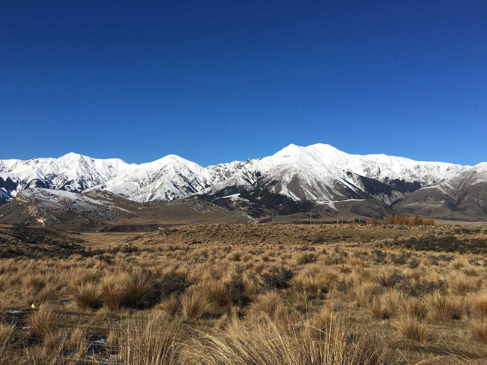

<header class="masthead">
  <picture>
    <source type="image/webp" srcset="images/IMG_9324-960.webp 960w, images/IMG_9324-1600.webp 1600w" sizes="100vw">
    
  </picture>
  <h1 id="mat-chavez" class="mc-vh">Mat Chavez</h1>
</header>

